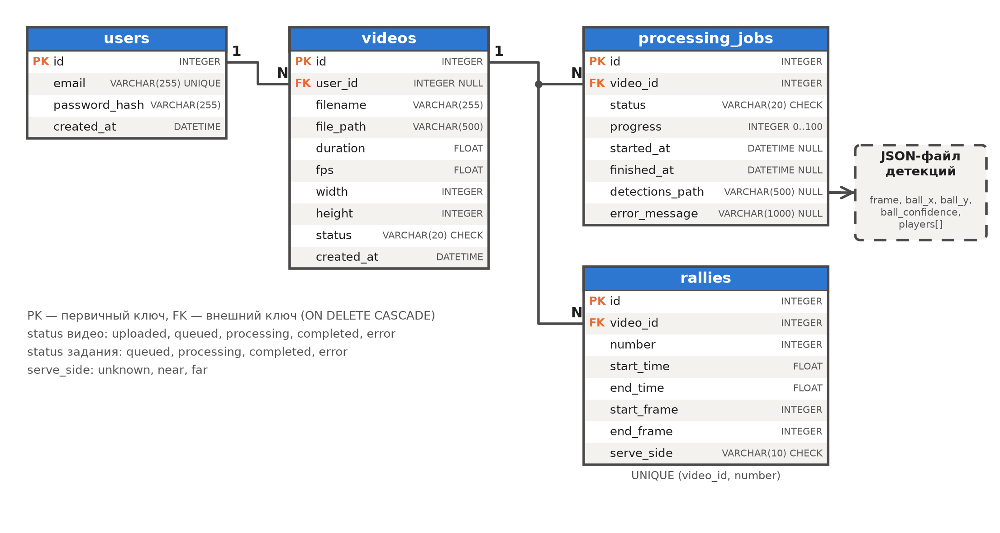
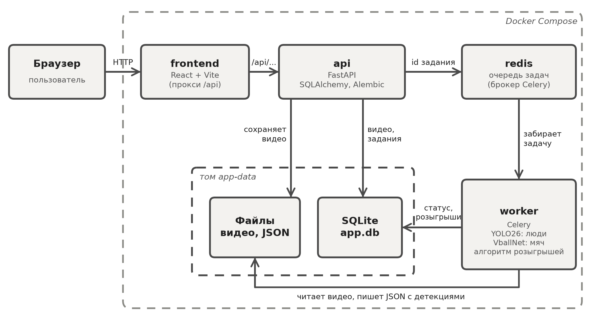

# Volleyball Practice

Сервис для анализа видео волейбольных матчей. Пользователь загружает запись игры, нейросети находят
на кадрах мяч и игроков, а простой алгоритм выделяет розыгрыши (rally): отрезки, когда мяч в игре.
Результат выдаётся в JSON (фрагмент настоящего результата для записи трансляции, время в секундах):

```json
{"rallies": [{"number": 2, "start": 20.68, "end": 29.04}, {"number": 3, "start": 43.0, "end": 52.2}]}
```

Учебный проект по практике, задания ИР 1 (проектирование системы и базы данных) и ИР 4
(нейросетевой анализ и выделение розыгрышей).

## Схема БД

База данных SQLite, модели написаны на SQLAlchemy 2.0, схема создаётся миграцией Alembic.



Таблицы:

- `users` — пользователи, пароль хранится только как хеш. Регистрации и входа в системе нет
  (это задание ИР 2), поэтому таблица пока пустая.
- `videos` — загруженные видео: имя файла, путь на диске, длительность, fps, размер кадра и статус
  (`uploaded`, `queued`, `processing`, `completed`, `error`).
- `processing_jobs` — запуски обработки видео: статус, процент выполнения, время начала и конца,
  путь к файлу с детекциями и текст ошибки. Повторный запуск создаёт новую запись, история сохраняется.
- `rallies` — найденные розыгрыши: номер, время начала и конца в секундах и кадрах, сторона подачи
  (`unknown`, `near`, `far`; пока всегда `unknown`).

## Как работает обработка



1. Пользователь выбирает видео на странице и нажимает «Обработать».
2. API (FastAPI) сохраняет файл, читает его fps, размер и длительность и создаёт запись в `videos`.
3. API создаёт запись в `processing_jobs` и кладёт задачу в очередь Redis.
4. Воркер (Celery) забирает задачу и читает видео пакетами по 9 кадров:
   - модель **VballNet** из [fast-volleyball-tracking](https://github.com/asigatchov/fast-volleyball-tracking-inference)
     находит мяч;
   - модель **YOLO26** ([Ultralytics](https://docs.ultralytics.com/ru/models/yolo26)) находит людей.
5. Для каждого кадра получается запись `frame, ball_x, ball_y, ball_confidence, players[]`.
   Весь этот временной ряд сохраняется в JSON-файл.
6. Алгоритм (`backend/app/rallies.py`) выделяет розыгрыши:
   - кадр считается игровым, если мяч найден и летит быстрее порога;
   - пропуски мяча до 1 с заполняются;
   - куски игры короче 2 с отбрасываются как шум;
   - куски с паузой до 2 с склеиваются в один розыгрыш.
7. Розыгрыши записываются в `rallies`, задача получает статус `completed`.
   Если обработка упала, статус становится `error`, а текст ошибки сохраняется.
8. Страница раз в 2 секунды спрашивает статус и в конце показывает таблицу розыгрышей и JSON.

## Структура проекта

```text
backend/
├── app/
│   ├── main.py          # API (FastAPI)
│   ├── models.py        # таблицы БД (SQLAlchemy)
│   ├── schemas.py       # формат ответов API
│   ├── database.py      # подключение к SQLite
│   ├── tasks.py         # фоновая задача Celery
│   ├── detection.py     # нейросети: мяч (VballNet) и люди (YOLO26)
│   ├── rallies.py       # алгоритм выделения розыгрышей
│   ├── video_utils.py   # fps, размер и длительность видео
│   └── config.py        # пути и настройки
├── alembic/             # миграции БД
├── models/              # веса нейросетей
└── scripts/             # анализ видео из консоли и оценка качества
frontend/                # страница на React
docs/                    # схемы, ER-диаграмма, графики
examples/                # ручная разметка и результаты эксперимента
docker-compose.yml       # запуск всего проекта
EXPLANATION.md           # подробное объяснение кода
report.docx              # отчёт по практике
```

## Запуск

Нужен Docker Desktop.

```bash
docker compose up --build
```

- страница: http://localhost:5173
- документация API: http://localhost:8000/docs

Первая сборка занимает несколько минут: скачиваются PyTorch и другие библиотеки.
Остановить: `docker compose down` (с флагом `-v` удаляются и данные).

Для проверки подойдёт короткий ролик из датасета автора fast-volleyball-tracking:

```bash
curl -L -o gtu_20250316_005.mp4 "https://huggingface.co/datasets/asigatchov/vball-net/resolve/main/test/match_gtu_20250316_backline/video/gtu_20250316_005.mp4"
```

Его обработка в Docker занимает около 30 секунд, результат — один розыгрыш 0,3–4,7 с.

## Анализ видео из консоли

Без веб-части, из папки `backend` (нужен Python 3.12 и `pip install -r requirements.txt`):

```bash
# найти розыгрыши в видео
python -m scripts.analyze_video путь/к/видео.mp4 --out results

# пересчитать розыгрыши по готовым детекциям с другими параметрами, без нейросетей
python -m scripts.analyze_video --detections results/видео_detections.json --max-gap 1.5

# сравнить с ручной разметкой и перебрать параметры
python -m scripts.evaluate ../examples/experiment/teva_kamnik_2012_part_detections.json \
    ../examples/ground_truth/teva_kamnik_2012_part.json --sweep
```

## Параметры алгоритма

| Параметр | По умолчанию | Смысл |
|---|---|---|
| `min_speed` | 0,1 ширины кадра/с | мяч быстрее считается летящим, медленнее — в руках или на полу |
| `max_gap` | 1 с | пропуск мяча внутри розыгрыша, который заполняется |
| `min_duration` | 2 с | более короткие куски игры отбрасываются |
| `merge_gap` | 2 с | куски с паузой не больше этой склеиваются в один розыгрыш |

## Хранение результатов нейросети

На 8 минутах видео нейросети дают 123 690 детекций (мяч и люди). Три варианта хранения:

| Вариант | Плюсы | Минусы |
|---|---|---|
| **1. Все детекции в SQLite** | любые выборки запросом SQL | 9,4 МБ на 8 минут (около 140 МБ на матч), запись миллионов строк блокирует базу |
| **2. JSON-файл + путь в БД** | файл 5,5 МБ, база маленькая, розыгрыши можно пересчитать без нейросетей | отдельную детекцию не выбрать без чтения файла |
| **3. Только итоговые розыгрыши** | самая маленькая база | детекции теряются, для новых параметров нужно заново гонять нейросети |

**Выбран вариант 2.** В базе хранятся пользователи, видео, задания и розыгрыши, а покадровые детекции
лежат в JSON-файле, путь к которому записан в `processing_jobs.detections_path`. Интерфейсу нужны
только розыгрыши, детекции записываются один раз и читаются целиком, а сохранённый файл позволяет
пересчитать розыгрыши с другими параметрами меньше чем за секунду.

## Результаты

- **Детекция мяча** на трёх роликах с ручной разметкой мяча: VballNet — F1 0,79–0,87,
  YOLO26 с классом «sports ball» — не выше 0,30. Поэтому мяч ищет VballNet, а YOLO26 — людей.
- **Розыгрыши** на фрагменте телетрансляции (8 минут, 16 розыгрышей размечены вручную): найдено
  13 из 16, покадровый F1 0,61.
- **Ограничения:** модель мяча обучена на статичной камере, поэтому на трансляции с монтажом мяч
  находится только в 35 % кадров розыгрышей. Сторона подачи не определяется.

Подробное объяснение кода — в [EXPLANATION.md](EXPLANATION.md).

## Лицензии

- Модели VballNet (`backend/models/*.onnx`) — MIT, © Alexander Sigatchov.
- YOLO26 и пакет `ultralytics` — AGPL-3.0.
