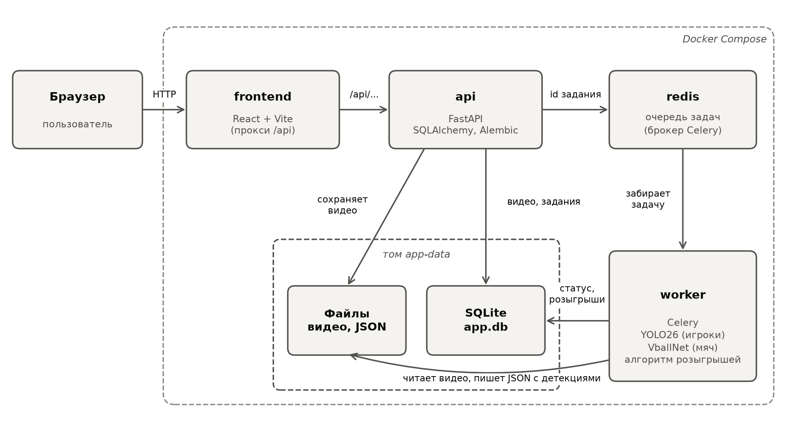
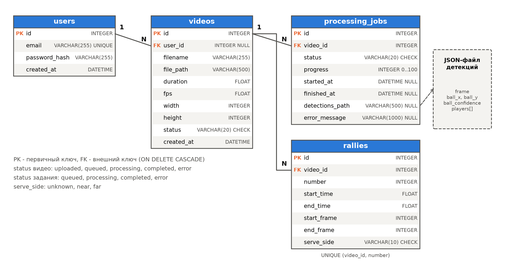
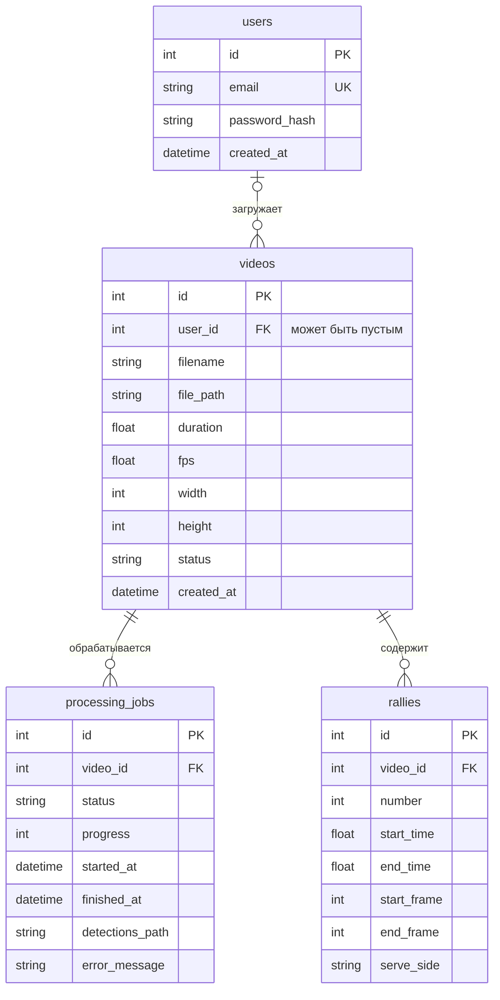

# Архитектура системы анализа волейбольных видео

## Назначение

Пользователь загружает запись волейбольного матча, система находит в ней игровые розыгрыши
(интервалы, когда мяч в игре) и сохраняет их. Тяжёлая нейросетевая обработка выполняется
в фоне, поэтому веб-интерфейс не «зависает», пока идёт анализ.

## Компоненты



| Компонент | Технология | Что делает |
|---|---|---|
| frontend | React + Vite | поле загрузки видео, ход обработки, найденные розыгрыши |
| api | FastAPI, SQLAlchemy, Alembic | HTTP API, сохранение файлов, постановка задач в очередь |
| redis | Redis | брокер сообщений: хранит очередь задач Celery |
| worker | Celery, OpenCV, YOLO26, ONNX Runtime | читает видео, запускает нейросети, выделяет розыгрыши |
| база данных | SQLite (файл `app.db`) | пользователи, видео, задания на обработку, розыгрыши |
| файлы | том Docker `app-data` | загруженные видео и JSON с покадровыми детекциями |

API и воркер собираются из одного образа `volleyball-backend` и работают с общим томом,
поэтому оба видят один и тот же файл базы и одни и те же видео.

## Сценарий работы

1. `POST /api/videos` — API сохраняет файл под случайным именем, читает через OpenCV FPS,
   размер кадра и длительность и создаёт запись `videos` со статусом `uploaded`.
2. `POST /api/videos/{id}/process` — API создаёт запись `processing_jobs` (статус `queued`),
   переводит видео в `queued` и отправляет в Redis задачу Celery `process_video(job_id)`.
   Интерфейс отправляет этот запрос сразу после загрузки.
3. Воркер забирает задачу, ставит статусы `processing`, обрабатывает видео пакетами по 9 кадров
   и после каждого пакета записывает процент выполнения в `processing_jobs.progress`.
4. Покадровые детекции сохраняются в JSON-файл, путь к нему — в `processing_jobs.detections_path`.
   Найденные розыгрыши записываются в таблицу `rallies`, статусы становятся `completed`.
   При ошибке статусы становятся `error`, текст ошибки — в `processing_jobs.error_message`.
5. Фронтенд раз в 2 секунды спрашивает статус (`GET /api/videos/{id}/job`), а после завершения
   получает розыгрыши (`GET /api/videos/{id}/rallies`).

## Жизненный цикл статусов

```
видео:   uploaded -> queued -> processing -> completed
                                         \-> error
задание:             queued -> processing -> completed
                                         \-> error
```

Повторный запуск возможен из состояний `uploaded`, `completed` и `error`. Пока видео в
очереди или обрабатывается, повторный запуск отклоняется с кодом 409.

## База данных





Связи: пользователь — много видео; видео — много заданий (каждый запуск обработки —
новое задание, история сохраняется); видео — много розыгрышей.

Ограничения целостности заданы в самой базе:

- внешние ключи с `ON DELETE CASCADE` (в SQLite включаются командой `PRAGMA foreign_keys=ON`
  при каждом подключении);
- `CHECK` на допустимые значения `status` и `serve_side`, `progress BETWEEN 0 AND 100`,
  `end_frame >= start_frame`;
- `UNIQUE(email)` и `UNIQUE(video_id, number)`;
- индексы по `videos.user_id` и `processing_jobs.video_id`; для `rallies.video_id` отдельный
  индекс не нужен — его заменяет уникальный индекс `(video_id, number)`.

Технические поля, которых нет в задании:

| Поле | Зачем |
|---|---|
| `videos.file_path` | путь к файлу на диске; `filename` хранит исходное имя, которое видит пользователь |
| `processing_jobs.detections_path` | путь к JSON с покадровыми детекциями (выбранный способ хранения) |
| `processing_jobs.error_message` | причина ошибки, чтобы показать её пользователю |

Поле `serve_side` пока всегда `unknown`: определение стороны подачи — бонусная задача
другого задания (ИР 5), поле заложено в схему заранее.

## Хранение результатов нейросети

Сравнивались три варианта. Объём измерен на реальных детекциях фрагмента матча
длиной 7 мин 56 с (`examples/experiment/teva_kamnik_2012_part_detections.json`).

| | 1. Все детекции в SQLite | 2. JSON/CSV + путь в БД | 3. Только итоговые Rally |
|---|---|---|---|
| Что в БД | таблица `detections`: строка на мяч или игрока в кадре | путь к файлу в `processing_jobs` | только `rallies` |
| Объём на 8 мин видео | 123 690 строк, 9,4 МБ | файл 5,5 МБ, в БД одна строка | несколько строк |
| Объём на 2 часа матча (оценка) | ~1,9 млн строк, ~140 МБ | ~83 МБ в файлах | несколько килобайт |
| Пересчёт розыгрышей с новыми параметрами | да, без нейросетей | да, без нейросетей | нет, нужен повторный инференс |
| Запросы к отдельным детекциям | удобно (SQL) | нужно читать файл целиком | невозможно |
| Нагрузка на SQLite | запись миллионов строк блокирует базу для API | нет | нет |
| Сложность | ещё одна таблица, миграции, индексы | минимальная | минимальная |

Выбран **комбинированный вариант (2 + 3)**: в SQLite лежат пользователи, видео, задания и
итоговые розыгрыши, а покадровые детекции — в JSON-файле, путь к которому записан в задании.
Причины:

- интерфейсу нужны только розыгрыши, отдельные детекции по SQL никто не запрашивает;
- детекции пишутся один раз и читаются целиком — для этого файл подходит лучше таблицы;
- SQLite допускает только одного пишущего; миллионы вставок от воркера мешали бы API;
- детекции не теряются: розыгрыши можно пересчитать с другими параметрами за доли секунды,
  не запуская нейросети заново (на CPU это примерно столько же времени, сколько длится видео).

Если понадобится анализировать траектории средствами SQL (например, для статистики по
игрокам), таблицу `detections` можно добавить отдельной миграцией.

## API

| Метод | Путь | Описание |
|---|---|---|
| GET | `/api/health` | проверка, что сервис работает |
| POST | `/api/videos` | загрузка видео (multipart, поле `file`) |
| GET | `/api/videos` | список загруженных видео |
| GET | `/api/videos/{id}` | данные видео и его статус |
| POST | `/api/videos/{id}/process` | поставить видео в очередь на обработку |
| GET | `/api/videos/{id}/job` | последнее задание: статус и прогресс |
| GET | `/api/videos/{id}/rallies` | найденные розыгрыши в JSON |

Автоматическая документация Swagger доступна по адресу `http://localhost:8000/docs`.

Регистрации и входа нет: это задание ИР 2. Таблица `users` создана по заданию ИР 1, а поле
`videos.user_id` пока остаётся пустым и будет заполняться, когда появится вход.

## Запуск

`docker compose up --build` поднимает четыре контейнера: `redis`, `api` (перед стартом
выполняет `alembic upgrade head`), `worker` (`celery -A app.tasks worker --concurrency=1`)
и `frontend` (Vite с прокси `/api` на контейнер `api`).
